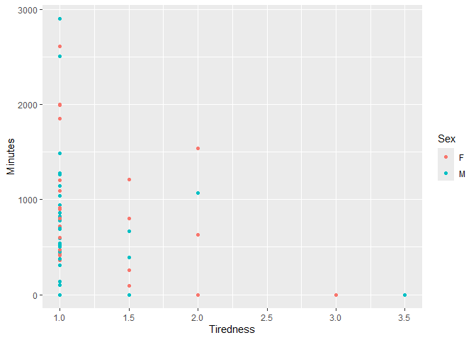
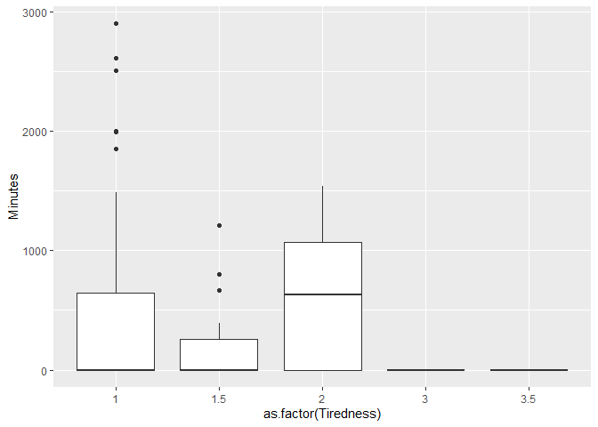
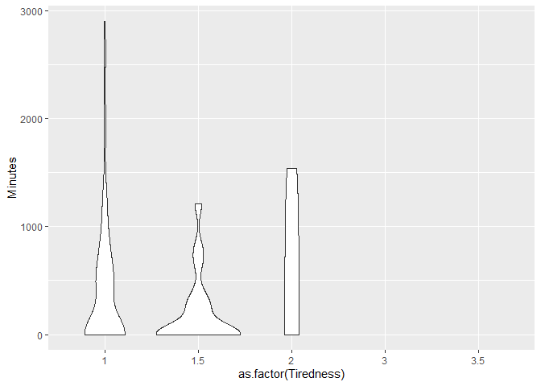
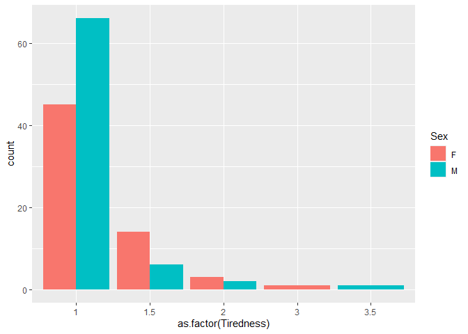
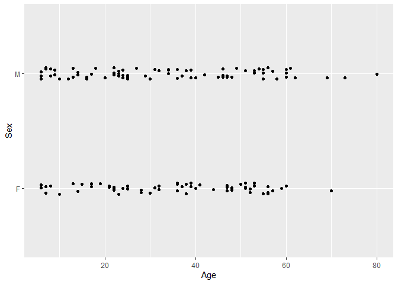
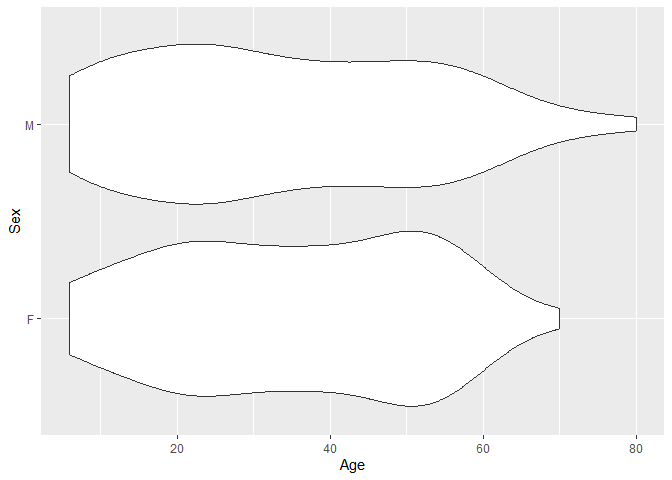
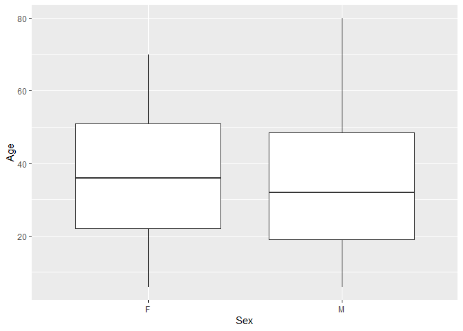

The Islands, Part 2: Study
================
Luca Odio
2026-11-10

- [Grading Rubric](#grading-rubric)
  - [Individual](#individual)
  - [Submission](#submission)
- [Setup](#setup)
  - [**q1** Planning a study (TEAMWORK)](#q1-planning-a-study-teamwork)
  - [**Initial data**](#initial-data)
  - [**New data**](#new-data)
  - [**q2** EDA](#q2-eda)
  - [**q3** Key Analyses](#q3-key-analyses)
  - [**q4** Answers](#q4-answers)

*Purpose*: This is part 2 of 2. In part 1 you *planed* your statistical
project, particularly your data collection. In this part you will give
updates on your plan, and report your findings.

This challenge is deliberately shorter so you have time to collect and
analyze your data.

*Important note*: While we expect that you did your data collection with
your team, you need to complete your own individual report for c10.

<!-- include-rubric -->

# Grading Rubric

<!-- -------------------------------------------------- -->

Unlike exercises, **challenges will be graded**. The following rubrics
define how you will be graded, both on an individual and team basis.

## Individual

<!-- ------------------------- -->

| Category | Needs Improvement | Satisfactory |
|----|----|----|
| Effort | Some task **q**’s left unattempted | All task **q**’s attempted |
| Observed | Did not document observations, or observations incorrect | Documented correct observations based on analysis |
| Supported | Some observations not clearly supported by analysis | All observations clearly supported by analysis (table, graph, etc.) |
| Assessed | Observations include claims not supported by the data, or reflect a level of certainty not warranted by the data | Observations are appropriately qualified by the quality & relevance of the data and (in)conclusiveness of the support |
| Specified | Uses the phrase “more data are necessary” without clarification | Any statement that “more data are necessary” specifies which *specific* data are needed to answer what *specific* question |
| Code Styled | Violations of the [style guide](https://style.tidyverse.org/) hinder readability | Code sufficiently close to the [style guide](https://style.tidyverse.org/) |

## Submission

<!-- ------------------------- -->

Make sure to commit both the challenge report (`report.md` file) and
supporting files (`report_files/` folder) when you are done! Then submit
a link to Canvas. **Your Challenge submission is not complete without
all files uploaded to GitHub.**

# Setup

<!-- ----------------------------------------------------------------------- -->

``` r
library(tidyverse)
```

    ## ── Attaching core tidyverse packages ──────────────────────── tidyverse 2.0.0 ──
    ## ✔ dplyr     1.2.1     ✔ readr     2.2.0
    ## ✔ forcats   1.0.1     ✔ stringr   1.6.0
    ## ✔ ggplot2   4.0.3     ✔ tibble    3.3.1
    ## ✔ lubridate 1.9.5     ✔ tidyr     1.3.2
    ## ✔ purrr     1.2.2     
    ## ── Conflicts ────────────────────────────────────────── tidyverse_conflicts() ──
    ## ✖ dplyr::filter() masks stats::filter()
    ## ✖ dplyr::lag()    masks stats::lag()
    ## ℹ Use the conflicted package (<http://conflicted.r-lib.org/>) to force all conflicts to become errors

``` r
library(rsample)

# TODO: Include any other packages you need
```

### **q1** Planning a study (TEAMWORK)

While you provided this plan in c08 (Part 1), please include your plan
here. In particular, describe how you updated your plan in response to
feedback.

#### Population

- Initially, we studied and compared the populations of Mahuti, Bonne
  Sante and Vardo, Ironbard. Incorporating feedback from the teaching
  team and using our data to calculate our required sample size, we
  pivoted to study just the population of Reading, Providence. Only
  individuals of age 5 and older were asked to participate in the
  survey.

#### Quantity of interest

- The quantities of interest are “tiredness” and “minutes of vigorous
  physical activity in the past week” as reported by the islander.

#### Covariates

- There are many potential covariates that could influence tiredness
  among the islanders. Some examples include sex, sleep quality, sleep
  quantity, diet, age, and illness.

#### Observation or experiment?

The Islands allows you to ask islanders to complete tasks. If you just
take measurements on your participants, then it’s an *observational
study*. But if you also introduce something that’s meant to change the
outcome of a measurement (e.g., drinking coffee before taking a test),
that’s called an *experimental study*. You need to decide whether your
study is observational or experimental.

- This is an observational study were we ask how many mintutes of
  vigerous physical activity per week and how tired the villager is on a
  scale from one to ten.

#### Question / Hypothesis

- How is the amount of vigorous physical activity done per week in
  minutes related to the amount of tiredness that a villager feels on a
  scale of 1 to 10?

#### Sampling plan

- Create a spreadsheet. Label the columns: Island, Town, House number,
  Age, Sex, Weekly minutes of vigorous physical exercise, Tiredness,
  First name, and Last name.
- Use The Islands digital population for study.
- Generate a study containing the following questions: “How many minutes
  did you spend doing vigorous physical activity in the last seven
  days?”, “On a scale from 1 to 10, how tired do you feel right now?”,
  and “Are you male or female?”.
- Identify the number of houses in the town of interest.
- Set a seed for reproducibility. Using sample(), generate a list of 85
  unique random house numbers from 1 to the maximum house number.
- During the day when the islanders are awake and available to survey,
  open each house from the generated list.
- For each individual over the age of 5 in the house, record the
  following: house number, first name, last name, age (as listed in the
  “About” tab), and sex. For each individual, request consent for the
  study.
- Ask every individual who consents to fill out the survey. Record their
  answers in a spreadsheet. For every individual who declines to
  participate, enter “NA” for the ‘tiredness’ and ‘minutes of physical
  exercise’ values.

To make sure our data is representative of our chosen population, we
randomly selected which houses in the town to survey. We took initial
data, and then used the means and standard deviations of that data to
calculate our required sample size for 80% target power using
StatsCalculators.

### **Initial data**

We conducted some initial data collection on the inhabitants of Mahuti,
Bonne Sante and Vardo, Ironbard following our established protocol.

``` r
# generate random house number sample for Mahuti
set.seed(306)
mahuti_houses <- sample(1:1299, 25)

# generate random house number sample for Vardo
n_houses <- 833 # Total number of houses
n_sample <- 25 # Desired sample size
set.seed(90) # Set a seed for reproducibility
df_numbers_random <-
  tibble(
    house = sample(
      1:n_houses, # All integers from 1 to n_houses
      n_sample, # Size of our sample
      replace = FALSE # Sample WITHOUT replacement
    )
  ) %>%
  # Arrange for our data collection convenience
  arrange(house)
df_numbers_random %>%
  pull(house)
```

    ##  [1]   2  24  51  55  79  84 107 162 223 283 314 325 335 404 475 476 477 487 520
    ## [20] 594 660 669 687 744 771

``` r
# import
df_Mahuti <- read_csv("./data/Islanders_Mahuti.csv")
```

    ## Rows: 50 Columns: 9
    ## ── Column specification ────────────────────────────────────────────────────────
    ## Delimiter: ","
    ## chr (5): Island, Town, Sex, First Name, Last Name
    ## dbl (4): House #, Age, Weekly minutes of vigorous physical exercise, Tiredne...
    ## 
    ## ℹ Use `spec()` to retrieve the full column specification for this data.
    ## ℹ Specify the column types or set `show_col_types = FALSE` to quiet this message.

``` r
df_Vardo <- read_csv("./data/Islanders_Vardo.csv")
```

    ## Rows: 53 Columns: 9
    ## ── Column specification ────────────────────────────────────────────────────────
    ## Delimiter: ","
    ## chr (7): Island, Town, Sex, Weekly minutes of vigorous physical exercise, Ti...
    ## dbl (2): House #, Age
    ## 
    ## ℹ Use `spec()` to retrieve the full column specification for this data.
    ## ℹ Specify the column types or set `show_col_types = FALSE` to quiet this message.

``` r
# clean
df_Mahuti <-
  df_Mahuti %>%
  rename(
    House_num = "House #",
    Tiredness = "Tiredness 1-10",
    Minutes = "Weekly minutes of vigorous physical exercise",
    First_name = "First Name",
    Last_name = "Last Name"
  )

df_Vardo <-
  df_Vardo %>%
  rename(
    House_num = "House #",
    Tiredness = "Tiredness 1-10",
    Minutes = "Weekly minutes of vigorous physical exercise",
    First_name = "First",
    Last_name = "last"
  )
```

We originally collected data and started to perform EDA on it by
starting with a t-test to see what the power of our data was.

``` r
tgroup1 <- df_Mahuti %>% 
  drop_na() %>% 
  pull(Minutes)

tgroup2 <- df_Vardo %>% 
  drop_na() %>%
  pull(Minutes)

rgroup1 <- df_Mahuti %>% 
  drop_na() %>% 
  pull(Tiredness)
rgroup2 <- df_Vardo %>% 
  drop_na() %>%
  pull(Tiredness)

t_test_result <- t.test(tgroup1, tgroup2)
```

    ## Warning in mean.default(y): argument is not numeric or logical: returning NA

    ## Warning in var(y): NAs introduced by coercion

``` r
t_test_result
```

    ## 
    ##  Welch Two Sample t-test
    ## 
    ## data:  tgroup1 and tgroup2
    ## t = NA, df = NA, p-value = NA
    ## alternative hypothesis: true difference in means is not equal to 0
    ## 95 percent confidence interval:
    ##  NA NA
    ## sample estimates:
    ## mean of x mean of y 
    ##  566.2162        NA

``` r
other_result <- t.test(rgroup1, rgroup2)
```

    ## Warning in mean.default(y): argument is not numeric or logical: returning NA
    ## Warning in mean.default(y): NAs introduced by coercion

``` r
other_result
```

    ## 
    ##  Welch Two Sample t-test
    ## 
    ## data:  rgroup1 and rgroup2
    ## t = NA, df = NA, p-value = NA
    ## alternative hypothesis: true difference in means is not equal to 0
    ## 95 percent confidence interval:
    ##  NA NA
    ## sample estimates:
    ## mean of x mean of y 
    ##  1.378378        NA

The first variable, minutes of physical activity in the past week, that
we were looking at did not have enough power to be differentiated
between the towns. Due to this lack of power, we collected additional
data focusing one town. 

### **New data**

Based on means and standard deviations from the initial data,
StatsCalculators’ sample size and power calculator indicated a required
sample size of 140 samples for a statistical power of 80% with 90%
confidence. We used a Cohen’s d value of 0.48, calculated from the same
data.

``` r
# generate random house number sample for Reading, Providence. 
# 1045 Houses total.
set.seed(839)
houses2 <- sample(1:1045, 85)
```

``` r
# load file
df_islanders <- read_csv("./data/Islanders_NEW_data.csv")
```

    ## Rows: 183 Columns: 9
    ## ── Column specification ────────────────────────────────────────────────────────
    ## Delimiter: ","
    ## chr (5): Island, Town, Sex, First Name, Surname
    ## dbl (4): House #, Age, Minutes, Tiredness
    ## 
    ## ℹ Use `spec()` to retrieve the full column specification for this data.
    ## ℹ Specify the column types or set `show_col_types = FALSE` to quiet this message.

``` r
# adjust column names and filter out NAs
df_islanders <- 
  df_islanders %>%
  drop_na() %>%
  rename(
    House_num = "House #",
    First_name = "First Name",
    Last_name = "Surname"
  )

# display data frame
head(df_islanders)
```

    ## # A tibble: 6 × 9
    ##   Island     Town   House_num   Age Sex   Minutes Tiredness First_name Last_name
    ##   <chr>      <chr>      <dbl> <dbl> <chr>   <dbl>     <dbl> <chr>      <chr>    
    ## 1 Providence Readi…         3    25 M         860         1 Desmond    Regan    
    ## 2 Providence Readi…         3    21 F        1270         1 Guylaine   Marques  
    ## 3 Providence Readi…        68    34 M           0         1 Lukas      Sorensen 
    ## 4 Providence Readi…        68    31 F           0         1 Simone     Burke    
    ## 5 Providence Readi…        68    13 M           0         1 Justin     Burke    
    ## 6 Providence Readi…        68     9 M           0         1 Etienne    Burke

### **q2** EDA

Conduct an EDA on your data. Add as many code chunks as you need. Ensure
your EDA gives enough context of the data for us to understand what
comes next in this report.

``` r
df_islanders %>%
  ggplot(aes(
    x = Tiredness,
    y = Minutes,
    color = Sex
  )) +
  geom_point()
```

<!-- -->

``` r
df_islanders %>%
  ggplot(aes(
    x = as.factor(Tiredness),
    y = Minutes,
  )) +
  geom_boxplot()
```

<!-- -->

``` r
df_islanders %>%
  ggplot(aes(
    x = as.factor(Tiredness),
    y = Minutes,
  )) +
  geom_violin()
```

    ## Warning: Groups with fewer than two datapoints have been dropped.
    ## ℹ Set `drop = FALSE` to consider such groups for position adjustment purposes.
    ## Groups with fewer than two datapoints have been dropped.
    ## ℹ Set `drop = FALSE` to consider such groups for position adjustment purposes.

<!-- -->

``` r
df_islanders %>%
  ggplot(aes(
    x = as.factor(Tiredness),
    y = Minutes,
    color = Sex
  )) +
  geom_jitter(width = 0.1)
```

<!-- -->

``` r
df_islanders %>%
  ggplot(aes(
    x = as.factor(Tiredness),
  )) +
  geom_bar()
```

<!-- -->

``` r
df_islanders %>%
  group_by(Sex) %>%
  ggplot(aes(
    x = as.factor(Tiredness),
    fill = Sex,
  )) +
  geom_bar(position = "dodge")
```

<!-- -->

``` r
df_islanders %>%
  ggplot(aes(
    x = Age,
    y = Sex
  )) +
  geom_jitter(height = 0.05, width = 0)
```

<!-- -->

``` r
df_islanders %>%
  ggplot(aes(
    x = Age,
    y = Sex
  )) +
  geom_violin()
```

<!-- -->

``` r
df_islanders %>%
  ggplot(aes(
    x = Sex,
    y = Age
  )) +
  geom_boxplot()
```

<!-- -->

``` r
# look at houses with 4+ people? plot minutes, plot tiredness (or color?)
```

### **q3** Key Analyses

Present the key analyses that support your questions / hypotheses. This
could include summary statistics (e.g., a proportion of Islanders),
grouped summary statistics (e.g., a proportion for group A, and for
group B), or visualizations (e.g., a histogram). This section should be
short, and every analysis should directly relate to q4.

do a t test between the two sexes, see if they have comparable
populations?

### **q4** Answers

Connect your Key Analyses to your questions / hypotheses. What did you
conclude from your study?
